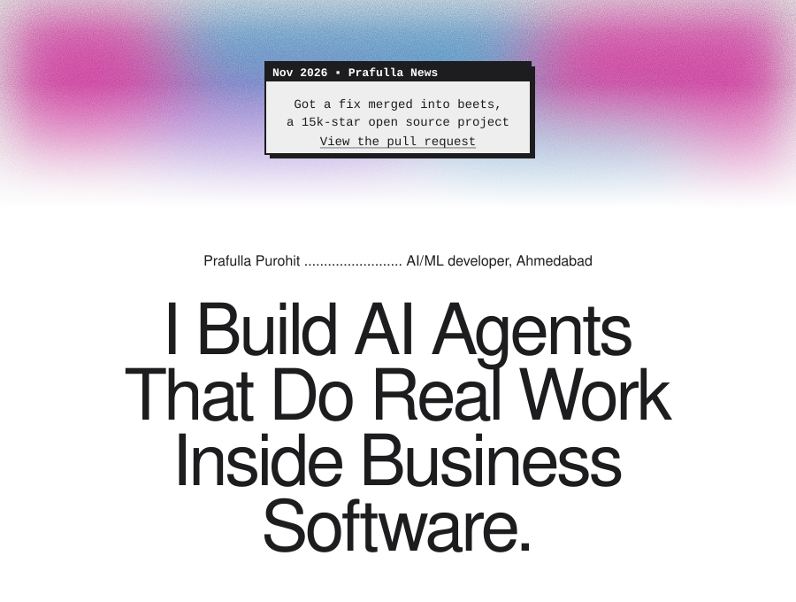
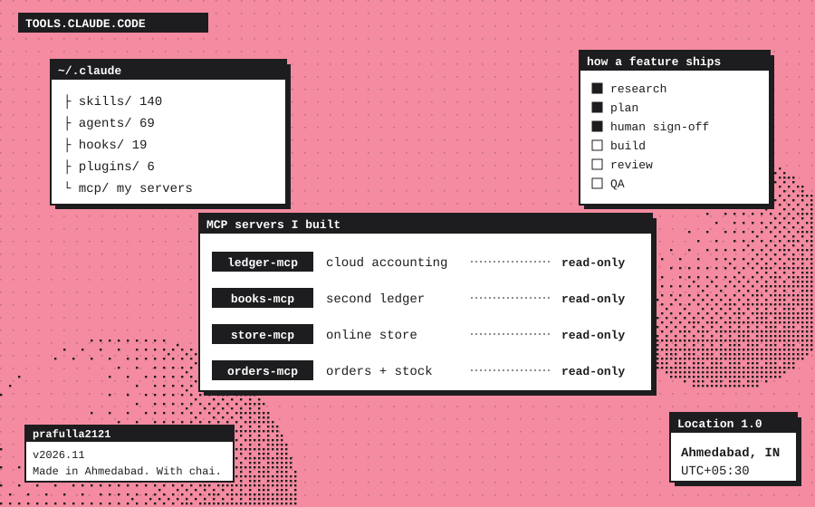
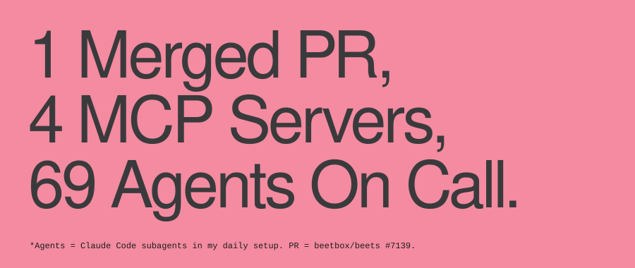
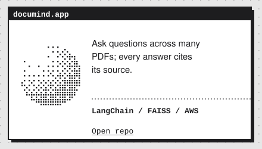
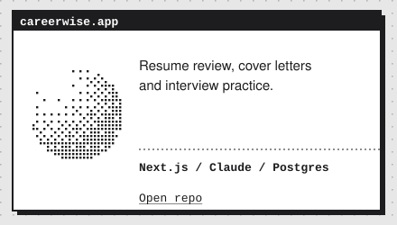
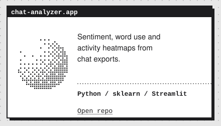
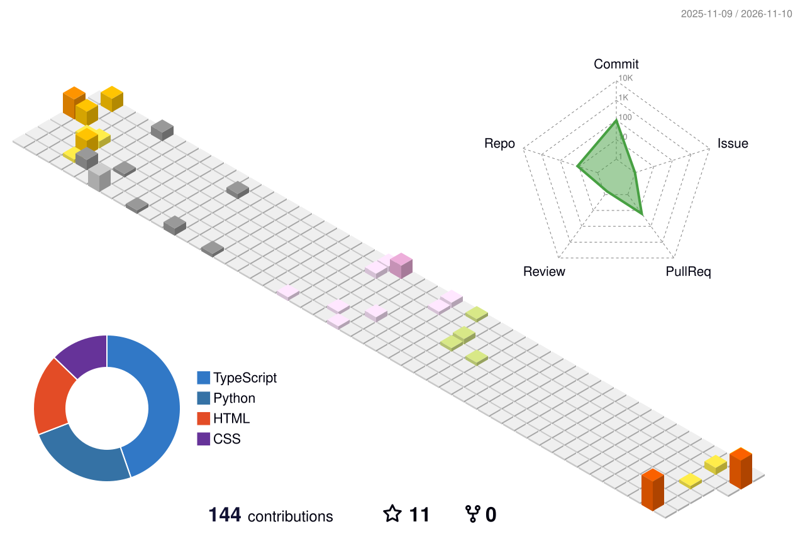

<a href="https://prafulla21.netlify.app">Portfolio</a> &nbsp;/&nbsp; <a href="https://linkedin.com/in/prafulla-purohit">LinkedIn</a> &nbsp;/&nbsp; <a href="https://x.com/21Prafulla">X</a> &nbsp;/&nbsp; <a href="https://github.com/beetbox/beets/pull/7139">beets #7139</a>

